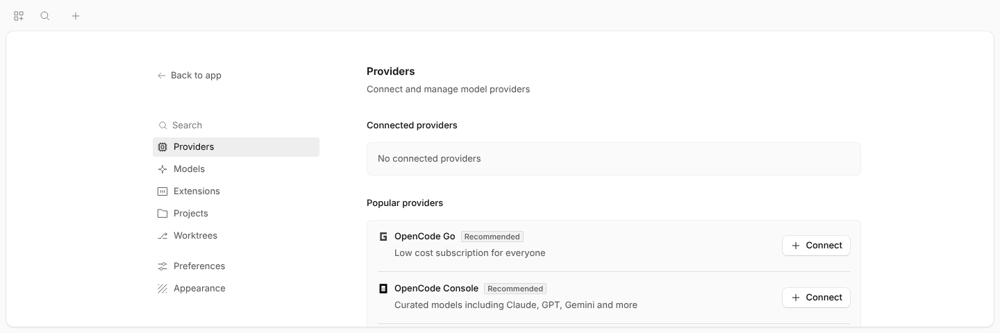

# OpenCode for Cloudron

A [Cloudron](https://cloudron.io) package for [OpenCode](https://opencode.ai), the open source AI
coding agent. It runs the OpenCode server and web UI behind your Cloudron login, with sessions,
settings, credentials and projects stored in the app's backed-up data directory.



This is a community package. It is not affiliated with Cloudron or the OpenCode team.

## Install

In the Cloudron dashboard, open **App Store → Community apps**, add this URL and install OpenCode:

```
https://github.com/mattstyles333/opencode-cloudron/blob/main/CloudronVersions.json
```

Or with the [Cloudron CLI](https://docs.cloudron.io/packaging/cli/):

```bash
cloudron install --versions-url https://raw.githubusercontent.com/mattstyles333/opencode-cloudron/main/CloudronVersions.json
```

Installed apps pick up new versions from the same URL.

## Signing in

At install time, choose how people reach OpenCode:

* **Cloudron login (recommended).** Visitors first see a small Cloudron page with the app's icon and
  a **Sign in** button. It takes them to your Cloudron login, with 2FA if enabled, and OpenCode then
  opens without its own password. Only users and groups you allow can get in.
* **No Cloudron login.** OpenCode asks for its server password. Read it from the Web Terminal with
  `opencode service get password` and choose **Use password** on the connect screen. With this mode
  you can also connect a local TUI: `OPENCODE_PASSWORD=... opencode --server https://opencode.example.com`.

To change the password, run `opencode service set password "a-long-secret"` in the Web Terminal and
restart the app. Changing it signs every OpenCode session out.

OpenCode can run any command inside the app container. Only give access to people you would trust
with a shell on it. See [SECURITY.md](SECURITY.md).

### One shared OpenCode

Everyone you let in uses the same OpenCode: the same sessions, projects, provider keys, settings and
terminal, all running as one user. There are no per-user accounts or permissions inside OpenCode.
For separate spaces, install the app more than once and give each install its own users or group.

## Using it

* **Providers.** Connect one under **Settings → Providers**, or set API keys such as
  `ANTHROPIC_API_KEY` in `/app/data/env.sh` and restart the app.
* **Projects.** Clone or create projects in `/app/data/workspace`, from the OpenCode terminal or the
  Cloudron Web Terminal, then add them in the web UI.
* **Configuration.** Global OpenCode config is `/app/data/home/.config/opencode/opencode.json`.
  OpenCode reloads it when it changes. See the [OpenCode docs](https://opencode.ai/v2/docs/config/).
* **Git and GitHub.** `git` and `gh` are installed. SSH keys go in `/app/data/home/.ssh`. Run
  `gh auth login` in the terminal to use GitHub.
* **More tools.** The image is read-only, so `apt` is unavailable, but `npm i -g` and
  `uv tool install` install into `/app/data/home/.local` and survive updates. For Python packages,
  use a virtual environment (`uv venv` or `python3 -m venv`). Node.js, Python, uv, ripgrep, fd and
  build tools are preinstalled.
* **Web Terminal.** Running `opencode` in the Cloudron Web Terminal starts the TUI as the app user,
  connected to the running server.

## Data and backups

| Path | Contents | Backed up |
| --- | --- | --- |
| `/app/data/workspace` | Projects. The server starts here | Yes |
| `/app/data/home` | Home directory: OpenCode config, provider credentials, git and SSH config | Yes |
| `/app/data/home/.local/share/opencode` | Undo snapshots and other OpenCode state | Yes |
| `/app/data/opencode.db` | Sessions and messages, backed up as a consistent SQLite copy | Yes |
| `/app/data/env.sh` | Extra environment variables, sourced on start | Yes |
| `/run/opencode` | npm, pnpm, yarn, bun, uv and pip caches, OpenCode's log file and reference repo checkouts | No, rebuilt on demand |

Dependency folders such as `node_modules` and `.venv` inside projects are backed up like any other
file and can make backups large. Keep projects in git, and either delete those folders when you're
done or keep big projects on a volume:

1. In the Cloudron dashboard, add a volume under **Storage → Volumes**, for example a directory under
   `/mnt` on the server. Make it writable by uid 1000, the app user.
2. Mount it in the app under **Storage → Mounts**. It appears at `/media/<volume name>`.
3. Create projects there and add them in the OpenCode web UI.

Volumes are not part of app backups; back them up separately.

The default memory limit is 2 GB. Raise it in the app's **Resources** settings if you run large
builds or language servers.

## Troubleshooting

* **The app shows "Not responding".** Open the app's **Logs**. OpenCode's server log is streamed
  there (lines with `role=server`). The health check only passes when the API and database answer.
* **OpenCode asks for a password although the Cloudron login is on.** The automatic sign-in didn't
  recognise the Cloudron proxy. Please [open an issue](https://github.com/mattstyles333/opencode-cloudron/issues)
  with the app log from startup.
* **You need the password, or want a new one.** In the Web Terminal, `opencode service get password`
  prints it. `opencode service set password "a-long-secret"` changes it; restart the app afterwards.
  Changing it signs every OpenCode browser session out.
* **The app keeps restarting or a build dies.** It probably hit the memory limit. Raise it under
  **Resources**.
* **A setting broke OpenCode.** Fix or move `/app/data/home/.config/opencode/opencode.json` from the
  Web Terminal or File Manager. OpenCode reloads it without a restart.
* **An update went wrong.** Cloudron backs the app up before every update. Restore that backup from
  the app's **Backups** tab, then report the problem.

## How it works

`start.sh` writes OpenCode's service config with a generated password, then supervisord runs
`opencode serve --service` on `127.0.0.1:4096` and nginx on port 8000 in front of it.

With the Cloudron login on, nginx adds the server credentials to requests from the container's
default gateway, which is where the Cloudron reverse proxy connects from after it has checked the
login. Requests from anywhere else, such as other containers on the Cloudron network, still need the
OpenCode password. With the Cloudron login off, nginx passes requests through unchanged.

`/healthcheck` makes an authenticated, database-backed API request internally and answers only
`ok` or an error, so it reveals nothing behind the password.

## Development

Build and test locally:

```bash
docker build -t opencode-cloudron .
test/smoke.sh opencode-cloudron                                          # this build only
test/smoke.sh opencode-cloudron ghcr.io/mattstyles333/opencode-cloudron:1.0.1  # and an upgrade
```

To try a build on your Cloudron, use `cloudron build` and `cloudron install` from this directory.

### Releasing

Every version goes through **testing** before it is **published**:

1. **Build.** Every push and pull request builds the image and runs `test/smoke.sh`: both sign-in
   modes, auth from the proxy and from other containers, the health check, restarts, a SQLite backup
   and restore, and an upgrade from the newest released version.
2. **Testing.** When a commit on `main` has a manifest version that isn't in `CloudronVersions.json`
   yet, the build pushes `ghcr.io/mattstyles333/opencode-cloudron:<version>`, adds the version as
   `testing` and creates a GitHub pre-release. Cloudron installs and updates to it with an
   "unstable" warning, so try it on your own Cloudron first.
3. **Release.** Run the **Release** workflow (Actions → Release → Run workflow). It marks the newest
   testing version `published`, tags the image `latest` and turns the pre-release into the latest
   GitHub release. Cloudrons then offer it as a normal update.

To withdraw a version, run the Release workflow with **revoke** and the version. Cloudron stops
offering it; installs that already have it keep it.

To ship a change of your own, bump `version` in `CloudronManifest.json`, add a matching section at
the top of `CHANGELOG` and merge to `main`.

A daily workflow checks for new releases of OpenCode, the Cloudron base image, the GitHub CLI and uv.
It keeps one pull request up to date with the bumps, the new package version and a changelog
section, and runs the build for it. Dependabot updates the GitHub Actions.

## Support

* Problems with this package: [GitHub issues](https://github.com/mattstyles333/opencode-cloudron/issues)
* Problems with OpenCode itself: [OpenCode issues](https://github.com/anomalyco/opencode/issues)
* Security: see [SECURITY.md](SECURITY.md)

## License

The packaging is MIT licensed. OpenCode is MIT licensed by its authors.
